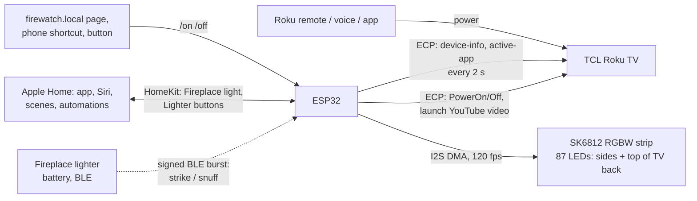

# Firewatch

Fireplace ambiance for a TCL 32S335 Roku TV sitting in a real firebox. An addressable LED strip around the back of the TV throws a self-generated firelight glow onto the brick. An ESP32 keeps the glow and the TV in sync: **press power on the Roku remote, and the glow swells in while the TV opens the YouTube fireplace.** Press it again and both go out.


*Offline render of the firmware's fire engine, with LEDs up the sides and across the top: a steady amber glow low on the sides, with the flicker concentrated across the top, where the flame tips would be.*

## How it works



- **One action either way.** Turning the TV on by any means makes the ESP32 start the glow and launch the fire video. Turning on the scene from Firewatch wakes the TV over Roku's network API (ECP). Off works the same way in both directions. See [feasibility](docs/feasibility.md).
- **Apple Home.** Firewatch shows up in the Home app as a dimmable **Fireplace** light that tracks the scene however it was started. Turning it on or off from Home, Siri, a scene or an automation does the same as `/on` and `/off`, and its brightness is the glow's. See [Apple Home and the lighter](#apple-home-and-the-lighter).
- **Fireplace lighter (optional).** A battery lighter from the [Skeumo](https://github.com/micahflock/Skeumo) project: open the lid and roll the wheel, and the fire catches; snap the lid shut and it's snuffed. It broadcasts a signed Bluetooth burst that Firewatch acts on immediately, and relays into Apple Home as button presses.
- **Smart plug alone doesn't work.** A Roku TV doesn't restart a streaming app after a power cut; it comes back to Home or a TV input. There's a 2-minute test to confirm this on your unit.
- **The fire is generated, not captured, and statistically matched to your video.** It models the *light a fire casts*: an even amber glow that's steady low on the sides, with flicker that grows toward the flame tips across the top, independent left/right movement, and occasional small flares. Its parameters and amber palette were fitted to measurements of the YouTube fireplace video ([feasibility §5](docs/feasibility.md#5-matching-the-glow-to-your-fireplace-video)), then temporally dithered from 16-bit at 120 fps so dim embers don't show 8-bit steps.

## Hardware (≈ $115–125 from scratch)

A QuinLED Dig-Uno (a classic ESP32 on an LED controller board with level shifter, fuse and screw terminals) + SK6812 RGBW warm-white 5 V 60 LED/m strip + a 5 V 3–4 A supply, in a 3D-printed enclosure that screws to the TV's VESA holes. The strip sits on 45° printed clips. Wiring is the Dig-Uno's screw terminals plus a handful of soldered joints, and the whole build uses only about ten separate purchases. The survey of alternatives, full shopping list, wiring, and power budget are in [docs/hardware.md](docs/hardware.md).

## Apple Home and the lighter

**Pairing.** In the Home app: **+ → Add Accessory → More options… → Firewatch**, then enter the setup code: **466-37-726**, or your own if you set `HOMEKIT_SETUP_CODE` in `secrets.h`. Accept the "uncertified accessory" prompt. Firewatch is a bridge, so you'll be asked to place its accessories (the Lighter only with `LIGHTER_ENABLED 1` in `config.h`):

| Accessory | What it is | Use it for |
|---|---|---|
| **Fireplace** | A dimmable light that is on while the fire scene is on (glow, TV, video), however it was started; its brightness is the glow's | "Hey Siri, turn on the fireplace". Add it to scenes. Automations like *When Fireplace turns on → dim the living room to 20% amber*. |
| **Lighter** | Buttons 1 **Strike** and 2 **Snuff** (single press), plus the lighter's battery level | Extra actions for a strike/snuff specifically. The fire itself is already handled (below). |

**The lighter lights the fire directly.** With `LIGHTER_DIRECT 1` (the default), a strike runs `/on` and a snuff runs `/off` inside Firewatch, within a few tenths of a second, even if the Home hub is unavailable. You don't need to bind the Strike button to the Fireplace. For the rest of the room, prefer an automation on **Fireplace turns on/off**. It then applies however the fire starts: remote, lighter, or Siri.

**Setup.** Put the same 32-hex-digit `SKEUMO_LINK_KEY` in Firewatch's `secrets.h` and in the lighter's (`python -c "import secrets; print(secrets.token_hex(16))"`). The lighter's hardware and firmware live in Skeumo's [`controllers/lighter`](https://github.com/micahflock/Skeumo/tree/main/controllers/lighter). `/status` shows the lighter's last frame, battery and signal strength. If you erase and re-flash the lighter, open `/lighter/reset` once so Firewatch accepts its restarted counter.

**First flash after this update must be over USB.** The firmware no longer fits the default 1.25 MB app slot, so it now uses the `min_spiffs` partition table (two 1.9 MB slots, OTA still works). A partition table can't be changed over the air.

## Repository

| Path | Contents |
|---|---|
| [`docs/feasibility.md`](docs/feasibility.md) | Smart plug vs. ECP vs. IR vs. follow-the-TV: what works and what it needs |
| [`docs/hardware.md`](docs/hardware.md) | Controller and strip survey, recommendation, parts list, wiring, mounting |
| [`docs/install.md`](docs/install.md) | TV settings, `curl` pre-flight checks, flashing, assembly, troubleshooting |
| [`firmware/`](firmware) | PlatformIO project (ESP32, Arduino) |
| [`firmware/lib/firecore/`](firmware/lib/firecore/src) | Portable core: fire engine, output stage, scene state machine, ECP parsers (host-tested) |
| [`firmware/lib/skeumo_link/`](firmware/lib/skeumo_link) | Signed BLE frames from the lighter (vendored from Skeumo, host-tested there) |
| [`hardware/mount/`](hardware/mount) | Parametric OpenSCAD source and printable STLs |
| [`tools/preview/`](tools/preview) | Renders the fire engine to a GIF on your computer (optionally with video frames on the TV) |
| [`tools/video_match/`](tools/video_match) | Measures a fireplace video's light from YouTube storyboards and fits the engine to it |

## Quick start

```sh
# 1. TV: Fast TV start ON, Control by mobile apps = Default, Power On = Home
# 2. Prove ECP works (docs/install.md step 2), then bench-test the strip with WLED (step 3)
cd firmware
cp include/secrets.example.h include/secrets.h && $EDITOR include/secrets.h
pio test -e native && pio run -e esp32 -t upload
open http://firewatch.local
```
