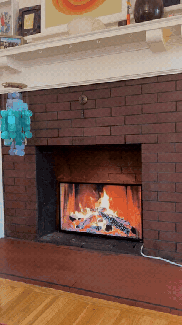
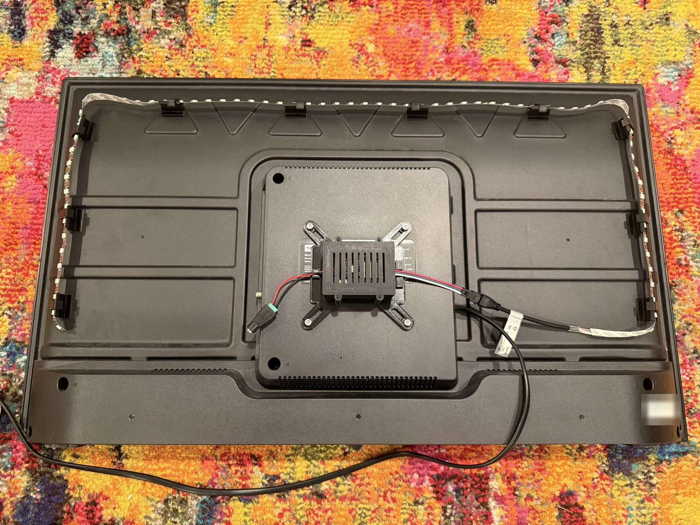
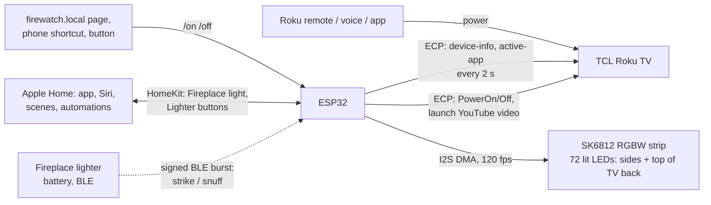
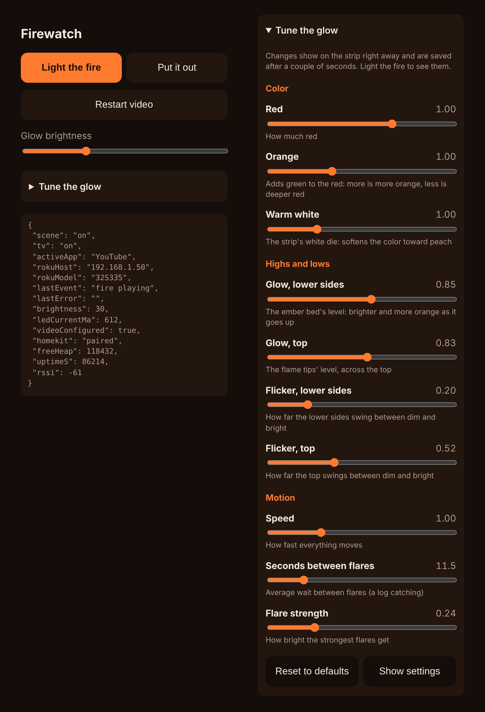
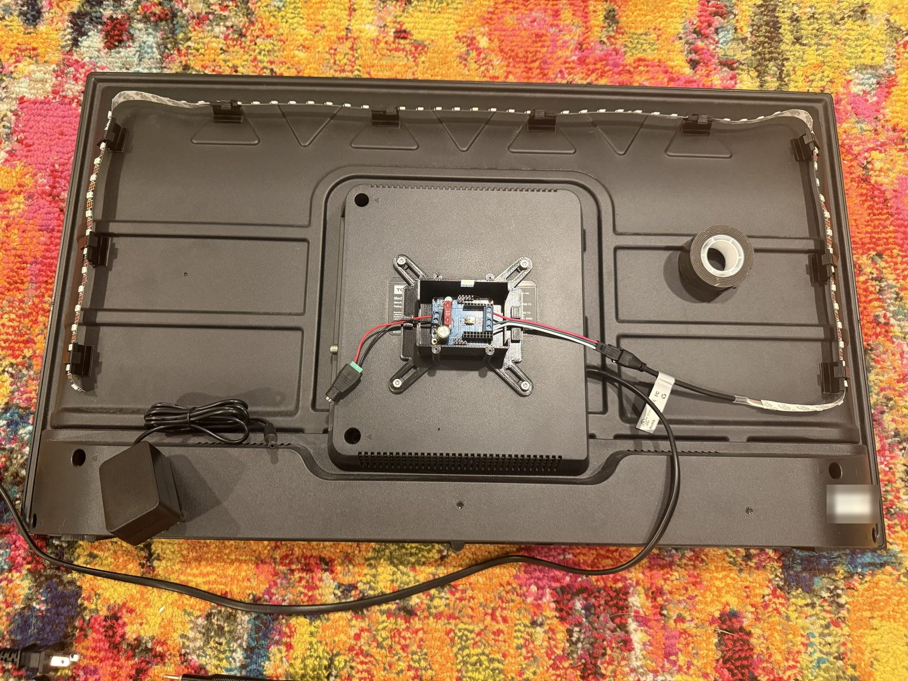
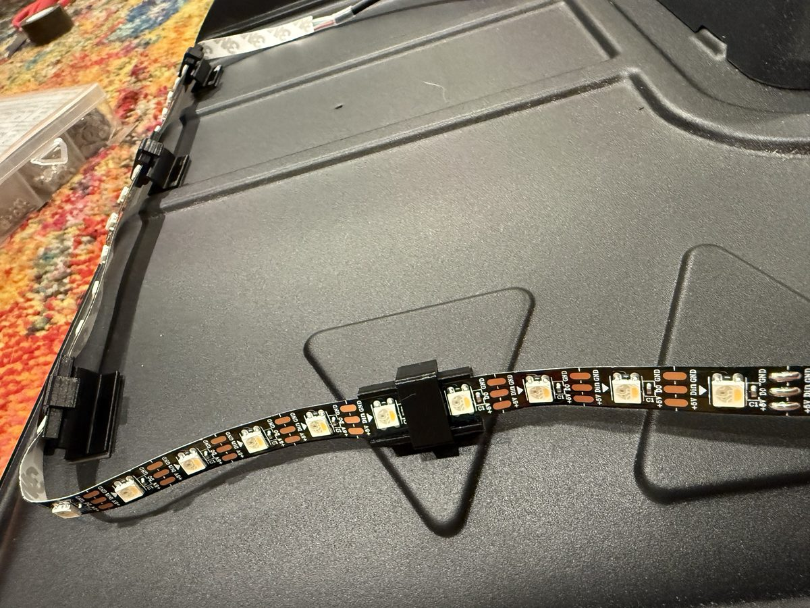
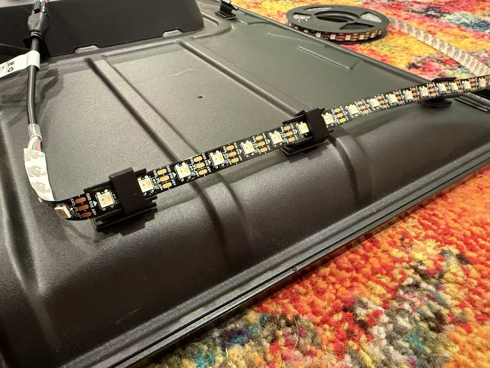

# Firewatch

**A TV in a real firebox that looks like a fire, and lights the brick around it like one.**

A 32" TCL Roku TV sits inside an unused brick fireplace, playing a YouTube log fire. An LED strip on the back of the TV throws a generated firelight glow onto the firebox walls, and an ESP32 keeps the two in step. **Press power on the Roku remote, and the glow swells in while the TV opens the fire video.** Press it again and both go out. It also works from Apple Home, Siri, a phone shortcut, or a Bluetooth "lighter" you strike like a real one.

<table>
<tr>
<td width="40%" align="center" valign="top">
<a href="docs/img/demo.mp4"></a><br>
<sub>Installed. Click for the full-resolution video.</sub>
</td>
<td width="60%" align="center" valign="middle">
<br>
<sub>The back of the TV: a 3D-printed enclosure on the VESA mount and 72 LEDs on printed clips up the sides and across the top.</sub>
</td>
</tr>
</table>

## Highlights

- **One action, from either side.** The ESP32 watches the TV over Roku's LAN API (ECP), so turning the TV on by *any* means (remote, voice, Roku app) starts the glow and launches the video. Turning the fire on from Firewatch wakes the TV. Off works the same way in both directions.
- **A fire engine fitted to the video.** The glow isn't captured from the screen. It's generated, with parameters fitted to measurements of the actual YouTube video's light, taken from 2,163 of its public storyboard frames.
- **Smooth at low brightness.** Colors are computed in 16-bit and temporally dithered to the strip's 8-bit at 120 fps, so dim embers fade without visible steps.
- **Apple Home bridge.** It shows up in the Home app as a dimmable **Fireplace** light that tracks the scene however it was started, so it works in Siri, scenes and automations.
- **A lighter that lights it.** An optional battery lighter from the companion [Skeumo](https://github.com/micahflock/Skeumo) project sends a signed, replay-protected Bluetooth burst: roll the wheel to light the fire, and snap the lid shut to put it out.
- **Built to be rebuilt.** The parametric OpenSCAD mount fits the controller board and both common VESA patterns. The scene logic, fire engine and parsers sit in a portable core library covered by 41 host unit tests.

## How it works



The ESP32 polls the TV's power state every 2 seconds and reacts to changes:

| When | Firewatch does |
|---|---|
| The TV turns on (remote, voice, app) | Fades the glow in, launches the fire video, and checks that YouTube came up (up to 3 tries) |
| The fire is turned on from Firewatch (web page, Home, lighter, button) | Fades the glow in now, then wakes the TV (Wake-on-LAN + `PowerOn`, retrying for up to 60 s) and launches the video once it's awake |
| The TV turns off | Fades the glow out |
| The fire is turned off from Firewatch | Fades the glow out and puts the TV to sleep |
| One poll goes unanswered | Nothing; it takes 3 in a row to count as off |
| The ESP32 reboots while the fire is on | Resumes the glow and leaves the video alone |

**Why not just a smart plug?** A Roku TV doesn't reopen a streaming app after a power cut; it comes back to its Home screen or a TV input. Talking to the TV over ECP is what makes one action work. [docs/feasibility.md](docs/feasibility.md) compares the four approaches: smart plug, ECP, IR blaster, and following the TV.

## The glow


*An offline render of the firmware's fire engine, made with [`tools/preview`](tools/preview).*

The engine models **the light a fire casts on the walls around it**, not the flames themselves:

- an even red-orange glow, nearly steady low on the sides where the ember bed would be,
- flicker that grows toward the flame tips across the top,
- left and right sides that move independently, and
- occasional small flares, like a log catching.

To match the video, [`tools/video_match`](tools/video_match) measures the light in the same U shape as the strip (left, top, right), and a parameter search fits the engine to it:

| Measure | Video | Engine |
|---|---|---|
| Overall light variation | 0.140 | 0.152 |
| Lower sides variation | 0.050 | 0.053 |
| Top variation | 0.302 | 0.255 |
| Top ÷ lower sides brightness | 1.06 | 1.04 |

The color was then reworked by eye on the installed strip. Matched exactly, it read as pale peach on the brick, so it now runs on red, uses green to set how orange it is, and adds the strip's warm-white die only to flares. The full analysis, including whether frame-level sync to the video is worth doing, is in [feasibility §5](docs/feasibility.md#5-matching-the-glow-to-your-fireplace-video).

## Control page

Firewatch serves its own page at `http://firewatch.local`, with on/off, video restart and brightness. Its **Tune the glow** panel adjusts color, levels and motion while the fire runs. Changes reach the strip on the next frame and are saved to flash.



The same endpoints (`/on`, `/off`, `/toggle`, `/brightness`, `/status`, `/tune`) work from a bookmark, a phone shortcut or a smart-home webhook.

## Hardware (≈ $115–125 from scratch)

| Part | Choice | Why |
|---|---|---|
| Controller | **QuinLED Dig-Uno v3** (classic ESP32) | Level shifter, fuse and screw terminals already on the board |
| LEDs | **SK6812 RGBW**, warm white, 5 V, 60 LED/m | 72 lit LEDs; the warm-white die adds body to flares |
| Power | 5 V, 3–4 A supply | Peaks around 1.6 A at full brightness; the firmware caps the budget at 2.5 A |
| Mount | 3D-printed (PETG, about 80 g) | Enclosure on the TV's VESA holes, plus 14 two-part 45° strip clips |

<table>
<tr>
<td width="50%" valign="top"><br><sub>The Dig-Uno in its enclosure, lid off: power in on the left, strip out on the right.</sub></td>
<td width="50%" valign="top"><br><sub>The parametric OpenSCAD mount: the X-shaped VESA plate fits both 75 and 100 mm patterns.</sub></td>
</tr>
<tr>
<td width="50%" valign="top"><br><sub>The strip bends around the top corners in one piece. A snap-on cap holds it between two LEDs.</sub></td>
<td width="50%" valign="top"><br><sub>Each clip holds the strip at 45°, aimed outward and back at the firebox walls.</sub></td>
</tr>
</table>

The controller and strip survey, full shopping list, wiring, power budget and print settings are in [docs/hardware.md](docs/hardware.md).

## Apple Home and the lighter

**Pairing.** In the Home app: **+ → Add Accessory → More options… → Firewatch**, then enter the setup code: **466-37-726**, or your own if you set `HOMEKIT_SETUP_CODE` in `secrets.h`. Accept the "uncertified accessory" prompt. Firewatch is a bridge, so you'll be asked to place its accessories (the Lighter only with `LIGHTER_ENABLED 1` in `config.h`):

| Accessory | What it is | Use it for |
|---|---|---|
| **Fireplace** | A dimmable light that is on while the fire scene is on (glow, TV, video), however it was started; its brightness is the glow's | "Hey Siri, turn on the fireplace". Add it to scenes. Automations like *When Fireplace turns on → dim the living room to 20% amber*. |
| **Lighter** | Buttons 1 **Strike** and 2 **Snuff** (single press), plus the lighter's battery level | Extra actions for a strike/snuff specifically. The fire itself is already handled (below). |

**The lighter lights the fire directly.** With `LIGHTER_DIRECT 1` (the default), a strike runs `/on` and a snuff runs `/off` inside Firewatch, within a few tenths of a second, even if the Home hub is unavailable. For the rest of the room, prefer an automation on **Fireplace turns on/off**. It then applies however the fire starts: remote, lighter, or Siri.

**Setup.** The lighter is off by default (`LIGHTER_ENABLED 0`), which leaves Bluetooth out of the build. To use it, put the same 32-hex-digit `SKEUMO_LINK_KEY` in Firewatch's `secrets.h` and in the lighter's (`python -c "import secrets; print(secrets.token_hex(16))"`). The lighter's hardware and firmware live in Skeumo's [`controllers/lighter`](https://github.com/micahflock/Skeumo/tree/main/controllers/lighter). `/status` shows the lighter's last frame, battery and signal strength. If you erase and re-flash the lighter, open `/lighter/reset` once so Firewatch accepts its restarted counter.

## Getting started

```sh
# 1. TV: Fast TV start ON, Control by mobile apps = Default, Power On = Home
# 2. Prove ECP works (docs/install.md step 2), then bench-test the strip with WLED (step 3)
cd firmware
cp include/secrets.example.h include/secrets.h && $EDITOR include/secrets.h   # Wi-Fi, TV IP
pio test -e native && pio run -e esp32 -t upload
open http://firewatch.local
```

After the first USB flash, updates go over Wi-Fi with `pio run -e esp32-ota -t upload`. The step-by-step guide, from TV settings to assembly and troubleshooting, is [docs/install.md](docs/install.md).

## Repository

| Path | Contents |
|---|---|
| [`docs/feasibility.md`](docs/feasibility.md) | Smart plug vs. ECP vs. IR vs. following the TV, and how the glow was matched to the video |
| [`docs/hardware.md`](docs/hardware.md) | Controller and strip survey, recommendation, parts list, wiring, mounting |
| [`docs/install.md`](docs/install.md) | TV settings, `curl` pre-flight checks, flashing, assembly, troubleshooting |
| [`firmware/`](firmware) | PlatformIO project (ESP32, Arduino): LED output, Roku client, web server, HomeKit, BLE |
| [`firmware/lib/firecore/`](firmware/lib/firecore/src) | Portable core: fire engine, live tuning table, output stage, scene state machine, Home sync, ECP parsers (host-tested) |
| [`firmware/lib/skeumo_link/`](firmware/lib/skeumo_link) | Signed BLE frames from the lighter (vendored from Skeumo, host-tested there) |
| [`hardware/mount/`](hardware/mount) | Parametric OpenSCAD source and printable STLs |
| [`tools/preview/`](tools/preview) | Renders the fire engine to a GIF on your computer (optionally with video frames on the TV) |
| [`tools/video_match/`](tools/video_match) | Measures a fireplace video's light from YouTube storyboards and fits the engine to it |

**Built with:** C++17 on Arduino-ESP32, [NeoPixelBus](https://github.com/Makuna/NeoPixelBus), [HomeSpan](https://github.com/HomeSpan/HomeSpan), [NimBLE-Arduino](https://github.com/h2zero/NimBLE-Arduino), [IRremoteESP8266](https://github.com/crankyoldgit/IRremoteESP8266), Unity for host tests, Python for the video analysis, and OpenSCAD for the mount.

## License

Firewatch is open source and open hardware, under three copyleft licenses:

| Part | License |
|---|---|
| Firmware and tools ([`firmware/`](firmware), [`tools/`](tools)) | [GPL-3.0-or-later](LICENSES/GPL-3.0-or-later.txt) |
| Mount designs ([`hardware/`](hardware)) | [CERN-OHL-S-2.0](LICENSES/CERN-OHL-S-2.0.txt) |
| Docs, photos and video ([`docs/`](docs), this README) | [CC BY-SA 4.0](LICENSES/CC-BY-SA-4.0.txt) |

You're welcome to build, remix, share and even sell it. If you distribute it or something made from it, credit "Firewatch by micahflock" with a link to this repo, and release your changes under the same license. [LICENSE](LICENSE) has the details.
