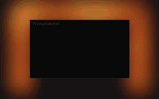
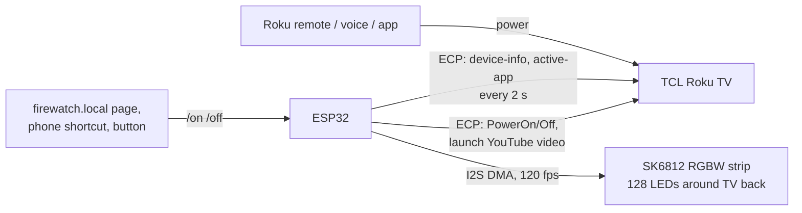

# Firewatch

Fireplace ambiance for a TCL 32S335 Roku TV sitting in a real firebox. An addressable LED strip around the back of the TV throws a self-generated firelight glow onto the brick. An ESP32 keeps the glow and the TV in sync: **press power on the Roku remote, and the glow swells in while the TV opens the YouTube fireplace.** Press it again and both go out.



*Offline render of the firmware's fire engine. The glow is brightest and most amber low and in the center, and redder toward the top, with slow sway, flicker, and occasional flares.*

## How it works



- **One action either way.** Turning the TV on by any means makes the ESP32 start the glow and launch the fire video. Turning on the scene from Firewatch wakes the TV over Roku's network API (ECP). Off works the same way in both directions. See [feasibility](docs/feasibility.md).
- **Smart plug alone doesn't work.** A Roku TV doesn't restart a streaming app after a power cut; it comes back to Home or a TV input. There's a 2-minute test to confirm this on your unit.
- **The fire is generated, not captured.** It models the *light a fire casts* on its surroundings, not a flame seen head-on: a bottom-heavy heat field, three-band flicker, upward-drifting noise, and random flares. It's mapped through a linear-light ember palette that uses the strip's warm-white die, then temporally dithered from 16-bit at 120 fps so dim embers don't show 8-bit steps.

## Hardware (≈ $150–165 from scratch, including parts packs)

A QuinLED Dig-Uno (a classic ESP32 on an LED controller board with level shifter, fuse and screw terminals) + SK6812 RGBW warm-white 5 V 60 LED/m strip + a Mean Well 5 V 4 A supply, in a 3D-printed enclosure that screws to the TV's VESA holes. The strip sits on 45° printed clips. The build is solder-free: screw terminals and Wago lever connectors. The survey of alternatives, full shopping list, wiring, and power budget are in [docs/hardware.md](docs/hardware.md).

## Repository

| Path | Contents |
|---|---|
| [`docs/feasibility.md`](docs/feasibility.md) | Smart plug vs. ECP vs. IR vs. follow-the-TV: what works and what it needs |
| [`docs/hardware.md`](docs/hardware.md) | Controller and strip survey, recommendation, parts list, wiring, mounting |
| [`docs/install.md`](docs/install.md) | TV settings, `curl` pre-flight checks, flashing, assembly, troubleshooting |
| [`firmware/`](firmware) | PlatformIO project (ESP32, Arduino) |
| [`firmware/lib/firecore/`](firmware/lib/firecore/src) | Portable core: fire engine, output stage, scene state machine, ECP parsers (host-tested) |
| [`hardware/mount/`](hardware/mount) | Parametric OpenSCAD source and printable STLs |
| [`tools/preview/`](tools/preview) | Renders the fire engine to a GIF on your computer |

## Quick start

```sh
# 1. TV: Fast TV start ON, Control by mobile apps = Default, Power On = Home
# 2. Prove ECP works (docs/install.md step 2), then bench-test the strip with WLED (step 3)
cd firmware
cp include/secrets.example.h include/secrets.h && $EDITOR include/secrets.h
pio test -e native && pio run -e esp32 -t upload
open http://firewatch.local
```
