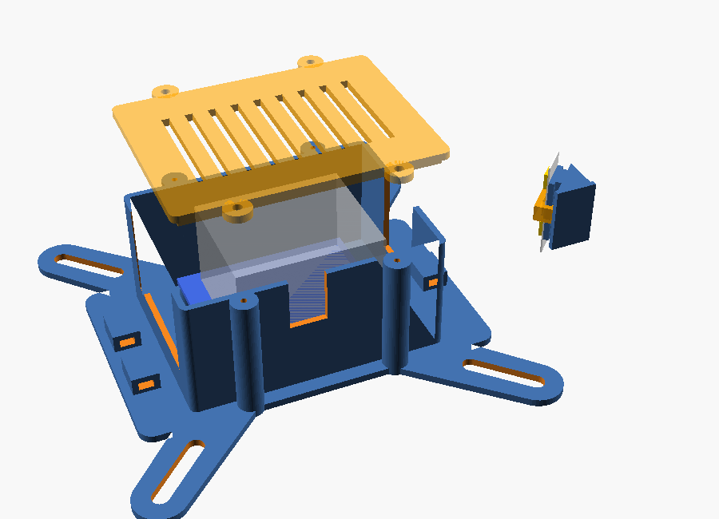
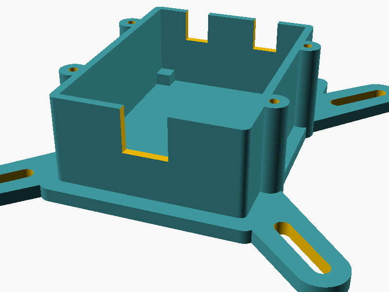
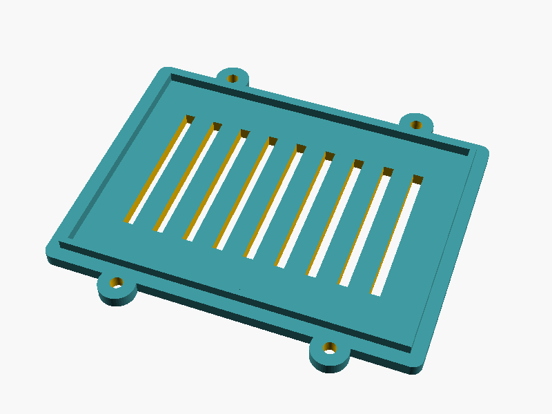

# Hardware: survey, recommendation, parts list, wiring

## What the job actually needs

- **Wi-Fi.** The controller has to talk to the Roku (ECP) and serve a small web page. This rules out plain MCUs.
- **Glitch-free LED timing while Wi-Fi is busy.** The LED bitstream should come from DMA hardware, not CPU bit-banging.
- **Good low-brightness color.** A fire glow in a dark room lives in the bottom 10–30% of an LED's range, where 8-bit channels show visible steps.
- **Warm color quality.** The light falls on brick, the mantel, and the room, so it should look like firelight, not like "RGB orange".
- **About 2.2 m of strip.** A loop set about 20 mm in from the edges of the TV's back (the TV is 731 × 437 mm). This is short enough that voltage drop is a non-issue at 5 V, especially since both ends of the loop come back to the same corner, so you can feed power from both ends.

The light doesn't need to be dotless or high-density. The strip faces the firebox walls, not the viewer, so all you see is diffuse reflection.

## Controller options

| Option | Strengths | Weaknesses | Verdict |
|---|---|---|---|
| **QuinLED Dig-Uno v3 (classic ESP32 on a LED carrier board)** | The same classic ESP32 as below, plus a level shifter, 10 A fuse, bulk capacitors, screw terminals, USB-C and a 5–24 V input on one board. No soldering, and no parts packs to buy. | $27.50–37.50 + shipping from a small shop; needs its own mount (provided) | **Chosen** |
| ESP32 dev board (classic, WROOM-32E DevKitC) + DIY perfboard | Same chip and firmware; cheapest *if you already have a parts bin* (≈$16 in parts) | You solder a level shifter, fuse, terminals and diode yourself; buying all those parts in packs from scratch costs more than a Dig-Uno | Good if you have parts on hand |
| ESP32-S3 | Native USB, more RAM, PSRAM variants | No benefit for 128 LEDs; the parallel-I2S LED drivers are younger on the S3 | Fine, not better |
| ESP32-C3 / C6 | Tiny and cheap | Single core shared with Wi-Fi; fewer RMT channels; C6 LED support is still young | Workable, not ideal |
| Raspberry Pi Pico 2 W | PIO gives perfect LED timing | HTTP, mDNS and OTA are less polished under Arduino; no real advantage here | No |
| Other ready-made ESP32 LED boxes (Gledopto, Athom "WLED" controllers) | Cased, cheap | Pinouts vary by vendor, less documented; not all expose USB for flashing | Workable; set `LED_PIN` |
| Raspberry Pi Zero 2 W | Could also drive a screen | Overkill, SD card wear, 30 s boot, no real-time I/O | No |

## LED strip options

| Strip | Supply | Color | Strengths | Weaknesses |
|---|---|---|---|---|
| WS2812B | 5 V | RGB, 8-bit | Cheap and everywhere | "Warm" is mixed from narrow red and green peaks, which looks synthetic on brick and wood. Steps at low brightness. |
| **SK6812 RGBW, warm-white (≈3000 K)** | 5 V | RGB + W, 8-bit | The white die is phosphor-converted and broad-spectrum, so the glow's body looks like real warm light. RGB adds the red and orange flicker on top. Same one-wire protocol and libraries as WS2812B. Better lumens per watt for warm tones. | Slightly pricier. W is also 8-bit (the firmware dithers). |
| WS2815 | 12 V | RGB | Backup data line, lower current | Needs a buck converter for the ESP32; RGB only; 12 V is pointless at 2.2 m |
| APA102 / SK9822 | 5 V | RGB + 5-bit global | Fast PWM; the 5-bit global brightness helps low end | Four wires, pricier, still RGB-only color |
| HD108 | 5 V | 16-bit RGB | Excellent dimming | Niche, expensive, young library support |
| COB/FCOB addressable (WS2811, 12/24 V) | 12/24 V | RGB, coarse segments | Dotless | Dots are invisible here anyway (the light is reflected); coarse addressing |


## Recommendation

**QuinLED Dig-Uno v3 (pre-assembled, with QuinLED-ESP32) + SK6812 RGBW warm-white, 5 V, 60 LED/m, 10 mm, IP30 + Mean Well 5 V 4 A supply**, in a printed enclosure screwed to the TV's VESA holes. The wiring uses the Dig-Uno's screw terminals and a few soldered joints, so the only wire you buy is one roll of 22 AWG 3-conductor.

Why this combination:
- **RGBW warm-white is the biggest quality lever.** Real firelight is broadband, and a phosphor white die gets much closer to it than any RGB mix. The fire palette ([`fire.cpp`](../firmware/lib/firecore/src/fire.cpp)) uses W for the glow's body and RGB for the red and orange movement.
- **Low-brightness steps are handled in software.** Colors are computed in 16-bit and temporally dithered to 8-bit at 120 fps. That's cheaper and simpler than moving to 16-bit or SPI LEDs.
- **The Dig-Uno is a classic ESP32** (the lowest-risk platform for Wi-Fi plus LEDs) with the support circuitry already built: level shifter, fuse, capacitors, terminals. If you're buying everything from scratch, it costs less than the packs of parts you'd need to build that yourself, and it removes the usual failure points: grounding, the level shifter, and power wiring.
- **60 LED/m over 30/m:** more headroom and a smoother glow for a few dollars more.
- **IP30 (uncoated):** silicone-coated strips trap heat, yellow over time, and hold adhesive worse. There's no moisture in a firebox that isn't burning.

**Dig-Uno facts this design relies on** (from QuinLED's [pinout guide](https://quinled.info/quinled-dig-uno-pinout-guide/) and [dimension drawing](https://quinled.info/2020/08/02/quinled-dig-uno-board-dimensions/)):

| | |
|---|---|
| PCB | 48.52 × 39.37 mm, 4× M2 holes on a 43.27 × 34.02 mm rectangle, about 30 mm tall with the ESP32 fitted |
| LED data | **LED1 terminal = GPIO16** (`LED_PIN`). A jumper can move it to GPIO1; leave it on GPIO16, because GPIO1 is the serial TX pin. |
| Button | GPIO0 (`BUTTON_PIN`) |
| Spare GPIO | Q1 = GPIO15, Q2 = GPIO12 on the Q1/Q2 header (5V, GND, 3V3, Q2, Q1). Q3/Q4 = GPIO2/32. |
| Power | 5–24 V in, 10 A ATO fuse fitted, 15 A continuous |

## Shopping list (from scratch)

This keeps the number of separate purchases small. It assumes you already have a soldering iron, solder, a multimeter, a wire stripper and flush cutters. Rough 2026 US prices; where a part only comes in packs, the price is for the pack.

| # | Part | Qty used | What to buy | ≈ $ |
|---|---|---|---|---|
| 1 | **QuinLED Dig-Uno v3, pre-assembled, with QuinLED-ESP32, onboard antenna** | 1 | [quinled.info](https://quinled.info/pre-assembled-quinled-dig-uno/) or a listed distributor | 27.50–37.50 + shipping |
| 2 | **SK6812 RGBW, warm white (≈3000 K), 5 V, 60 LED/m, 10 mm, IP30** (e.g. BTF-LIGHTING) | 2.2 m (128 LEDs) | 5 m reel | 35 |
| 3 | **Mean Well GST25A05-P1J** (5 V 4 A desktop supply, 5.5 × 2.1 mm center-positive plug, short-circuit protected) | 1 | | 15 |
| 4 | Female 5.5 × 2.1 mm DC barrel jack pigtail (pre-wired, ~15–20 cm leads) | 1 | Pack of 5–10. Its leads go into the Dig-Uno's power input, so the supply unplugs at the jack. | 7 |
| 5 | 22 AWG 3-conductor LED wire | ~1.5 m | 5 m roll. It's used for every connection: strip start, strip end feed, and corner bridges. | 8 |
| 6 | Heat-shrink tubing | a few pieces | Small assortment | 7 |
| 7 | M4 × 12 mm pan-head screws | 4 | Small pack (VESA) | 6 |
| 8 | M2 × 8 mm self-tapping pan-head screws | 8 | Pack. They hold the board (4) and the lid (4). | 7 |
| 9 | 3M VHB tape, 12 mm (e.g. 5952) | ~0.5 m | Roll | 12 |
| 10 | Cable ties (≤ 3.6 mm wide) | a few | Pack | 4 |
| 11 | Printed parts: `firewatch_base.stl`, `firewatch_lid.stl`, 20 × `strip_clip_10mm.stl` | | PETG, about 90 g | — |
| | **Total** | | | **≈ $130–140 + Dig-Uno shipping** |

**What got cut, and why:**
- **Wago connectors:** solder joints under heat-shrink do the same job.
- **18 AWG wire:** at under 3 A over less than a metre, 22 AWG drops under 0.2 V.
- **Washers:** the M4 pan heads are wider than the 4.5 mm slots.
- **Adhesive cable clips:** leftover VHB holds the wire runs down.

**Optional IR blaster.** Only needed if you can't use Fast TV start; see [feasibility](feasibility.md#3-ir-blaster-fallback).

| Part | Qty | Notes |
|---|---|---|
| 940 nm IR LED (e.g. Vishay TSAL6200) | 1 | Aim it at the IR window on the TV's front bottom edge |
| PN2222A NPN transistor | 1 | |
| 1 kΩ (base) and 33 Ω (LED) resistors | 1 each | About 100 mA pulses from 5 V |
| Female-female Dupont jumper wires | 3 | Cut one end off. They plug onto the Q1/Q2 header, and the spare 22 AWG wire carries the run to the LED. |

## Wiring

```
 GST25A05 ──plug──► female barrel pigtail ──► Dig-Uno power input  (+ / −)
                    (cable-tied to the anchor beside the box)

 Dig-Uno LED output terminal
     5V   ─┬─ 22AWG ─────────────────────────►  strip START  +5V pad
           └─ 22AWG ─────────────────────────►  strip END    +5V pad   (power injection)
     LED1 ─── 22AWG (GPIO16, level-shifted) ─►  strip START  DIN pad
     LED2     (unused)
     GND  ─┬─ 22AWG ─────────────────────────►  strip START  GND pad
           └─ 22AWG ─────────────────────────►  strip END    GND pad

 Optional IR (Q1/Q2 header):  Q1 (GPIO15) ─[1k]─ PN2222 base; emitter → GND;
     collector → IR LED cathode; IR LED anode ─[33Ω]─ 5V.   Then set IR_LED_PIN 15.
```

Notes:
- **Supply polarity.** Pigtail lead colors aren't guaranteed. Plug the supply in, check which lead is + with a multimeter (leads apart), and unplug it again before landing them in the terminal.
- **Strain relief.** Cable-tie the pigtail's jack to one of the power-side anchors, so unplugging the supply pulls on the anchor, not the screw terminal.
- **Both strip feeds share the Dig-Uno's fused output.** Two 22 AWG wires go into each of the 5V and GND screws: twist each pair's strands together and don't tin them. Tinned wire in a screw terminal loosens over time. The loop starts and ends at the same corner, so both runs are short. QuinLED's own guidance for 5 V strips of this length is to feed both ends.
- **Strip ends.** Cut the JST plug and loose power leads off both ends of the strip, and solder the 22 AWG runs directly to the copper pads. Check the arrows: data must enter at the **start**. Leave the end's DIN/DOUT pad unconnected. The strip end's feed only needs two of the cable's three conductors.
- **Common ground** is automatic: everything shares the supply's GND at the Dig-Uno.
- **Don't cut strip power when "off".** An unpowered strip gets back-powered through its data line. Idle draw is about 1 mA per LED (≈0.6 W) plus about 0.5 W for the ESP32.
- **Flash over USB-C with the supply unplugged.** After the first flash, updates go over Wi-Fi.

## Power budget

| | Current (5 V) |
|---|---|
| Theoretical max: 128 LEDs × 4 channels × ~15 mA | 7.7 A (never reached) |
| Firmware cap (`POWER_BUDGET_MA`), including the ESP32 | 3.0 A |
| Fire at 60% brightness (default), firmware estimate over 100 s, all-in | avg 1.2 A, peak 1.4 A |
| Fire at 100% brightness | avg 1.8 A, peak 2.0 A |
| Off (ESP32 on Wi-Fi + strip idle) | ≈ 0.2 A (≈ 1.1 W) |

The web page shows the firmware's live current estimate (`ledCurrentMa`). The Dig-Uno's 10 A fuse and 15 A rating leave plenty of margin. The 4 A supply is the real limit.

## Mounting



  

Source: [`hardware/mount/firewatch_mount.scad`](../hardware/mount/firewatch_mount.scad) (parametric, with the Dig-Uno dimensions from QuinLED's drawing). STLs are in [`hardware/mount/stl/`](../hardware/mount/stl).

| File | What | Print |
|---|---|---|
| `firewatch_base.stl` | X-shaped VESA plate + Dig-Uno enclosure. The diagonal slots fit **both 75 × 75 and 100 × 100** (the 32S335 is 100 × 100, M4). Four M2 standoffs on the Dig-Uno's hole pattern. A wide window on the power end for the barrel-jack pigtail's leads **and USB-C access**, a notch on the LED end for the strip wiring, a small notch for the optional IR lead, and three cable-tie anchors. | Flat side down, 3 walls, 20% infill, no supports |
| `firewatch_base_M6.stl` | Same, with M6 clearance slots for other TVs | |
| `firewatch_lid.stl` | Vented lid with a locating lip; four M2 screws | Flat (outer) face down, no supports |
| `strip_clip_10mm.stl` / `strip_clip_12mm.stl` | 45° clip that holds the strip facing outward and backward toward the firebox walls. The strip slides in from the end, and lips hold the PCB edges clear of the LEDs. | **Profile face down** (as exported). 20 needed. |

The Dig-Uno fits with its power terminal and USB-C toward the window end and its LED output toward the notch end. The standoffs only fit that way round, or rotated 180°.

**Installing the base:** use M4 × 12 pan-head screws through the 4 mm plate, which gives about 8 mm of thread engagement. Turn each screw in by hand first: if one stops before the head seats, it's bottoming out in the insert, so use a shorter screw rather than forcing it. The slots near the 75 mm positions sit close to the box walls, so use a screwdriver with a shaft of at least 75 mm. The 100 mm positions have plenty of clearance.

**Wi-Fi:** the board sits between the TV's metal chassis and the brick. Check the signal (`rssi` on the status page, in dBm). If it's worse than about −75, QuinLED sells an external-antenna version of the ESP32 board, and its lead can leave through the power window.

**Strip placement:** put clips about 20 mm in from the TV's outer edge, every ~15 cm, plus one on each side of every corner (about 16–20 in total), with the channel opening pointing outward. **At corners, cut the strip at the copper cut marks and bridge the three pads with short lengths of the 22 AWG 3-conductor wire**, soldered on the bench before fitting. Folding the strip also works and saves the joints, but it stresses the flexible PCB and costs about one LED of length per corner. Clean the TV back with isopropyl alcohol before applying the VHB, and press for 30 s. If your per-side LED counts differ from 23/41/23/41, put them in `kLedLayout`.
